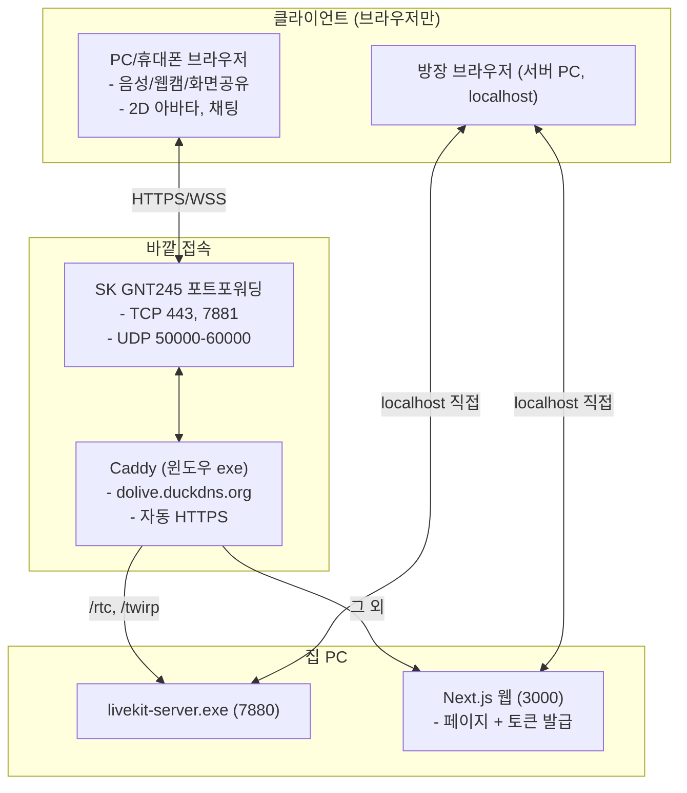

# [기획서] AI 동호회 전용 화상/음성 소통 플랫폼: DOLIVE

> 최종 수정: 2026-09-26. 녹화·AI 요약·음성 인식 기능은 사용자 결정으로 **제외**. 모바일 앱·도커·Redis도 제외.

---

## 1. 프로젝트 개요

* **서비스명**: **DOLIVE** (Do Live)
* **목적**: 디스코드처럼 가볍게 음성·화상·화면공유를 하면서, 동호회용 **음성 반응형 2D 아바타**로 얼굴 없이도 편하게 이야기하는 소통 플랫폼.
* **접속**: **웹 전용**. PC·휴대폰 모두 브라우저로 URL + 닉네임만 입력해 참여 (별도 앱 없음).
* **운영 인프라**: 서버 비용 0원. 개발자 집 PC(Windows 11)를 홈 서버로 사용. **도커 없이** 윈도우 프로그램을 직접 실행.
* **규모**: 한 방 동시 접속 **11~20명** 목표.

---

## 2. 확정 사양 및 정책

| 구분 | 확정 사양 | 구현 방식 |
| :--- | :--- | :--- |
| **인증/접속** | 가입 없이 **닉네임 + 캐릭터 선택** | 브라우저 세션 스토리지에 닉네임·캐릭터 저장, 입장 시 토큰 발급 |
| **입장 제한** | 없음 (주소를 알면 누구나) | 사용자 결정 |
| **방 형태** | **고정 방 몇 개** (`study` 스터디방, `lounge` 잡담방) | `apps/web/lib/dolive.ts`의 배열. 주소 예: `/room/study` |
| **휘발 정책** | 모두 나가면 채팅 사라짐 | 채팅은 서버에 저장하지 않고 LiveKit으로만 전달 |
| **방장** | **서버 컴퓨터에서 접속한 사람** (표시만) | `localhost`로 직접 들어온 요청만 방장. Caddy를 거치면 방장 아님 |
| **미디어 모드** | 아바타+음성 / 화면공유(1080p) / 웹캠 | LiveKit 트랙 토글. 웹캠 540p, 화면공유만 1080p |
| **2D 아바타** | 음성 반응형 4종 (PNGtuber) | LiveKit 발화 감지 → `idle.png` / `talk.png` 전환 + 바운스 |

---

## 3. 시스템 구조



---

## 4. 화면 구성 (디스코드식 3단)

```
+---------------------------------------------------------------------------------------------------+
|  DOLIVE  # 스터디방  👥 5명                                                            [방장]       |
+-------------------+-----------------------------------------------------------+-------------------+
| [참여자 & 아바타]  |                       [메인 스테이지]                      |    [실시간 채팅]   |
| 🐱 철수 (말하는 중) |   화면공유(1080p) 또는 웹캠/아바타 칸                      | [14:02] 영희: ...  |
| 🤖 영희 (대기 중)   |                                                           |                   |
| 🦊 민수 (음소거)    |   (마이크) (캠) (화면공유) (캐릭터변경) (나가기)            |                   |
+-------------------+-----------------------------------------------------------+-------------------+
```

* 휴대폰(좁은 화면): 메인 스테이지만 보이고, 참여자·채팅은 버튼으로 열고 닫음.

---

## 5. 2D 음성 반응형 아바타

* **에셋**: `assets/avatars/<영어이름>/idle.png`, `talk.png` (512×512, 투명 배경, 두 장은 입만 다름). Codex 제작.
* 캐릭터 목록 (`apps/web/lib/dolive.ts`): cocomong 코코몽, doraemon 도라에몽, pororo 뽀로로, shinchan 짱구
* 캐릭터를 늘리려면 그림 폴더를 넣고 목록에 한 줄 추가 → `start_dolive.ps1 -Build`.
* 그림이 없으면 임시 동그라미 얼굴. 브라우저에 저장된 캐릭터가 목록에 없으면 첫 캐릭터로.
* 말하면 `talk.png` + 바운스, 음소거면 어둡게 + 🔇 뱃지. 캐릭터는 참가자 속성(attributes)으로 모두에게 공유.

---

## 6. 폴더 구조

```
DOLIVE/
├── apps/web/                # Next.js 웹 (페이지 + 토큰 발급 API)
├── server/
│   ├── bin/                 # livekit-server.exe, caddy.exe
│   ├── config/              # livekit.yaml, Caddyfile, duckdns.env
│   └── logs/
├── scripts/start_dolive.ps1 # 전부 켜기 (-Local, -Build, -Stop)
└── assets/avatars/          # 4종 캐릭터 (idle.png, talk.png)
```

---

## 7. 진행 상황

* **1단계 완료**: LiveKit 윈도우 exe 설치·실행
* **2단계 완료**: 웹 (닉네임·캐릭터·고정 방, 3단 화면, 음성/캠/화면공유, 아바타, 채팅, 방장 표시)
* **3단계 완료**: DuckDNS + Caddy HTTPS + 포트포워딩. 휴대폰(LTE) 접속 확인
* ~~4단계: 녹화 + AI 요약~~ → 제외
* **캐릭터 그림 적용 완료**: 코코몽, 도라에몽, 뽀로로, 짱구
