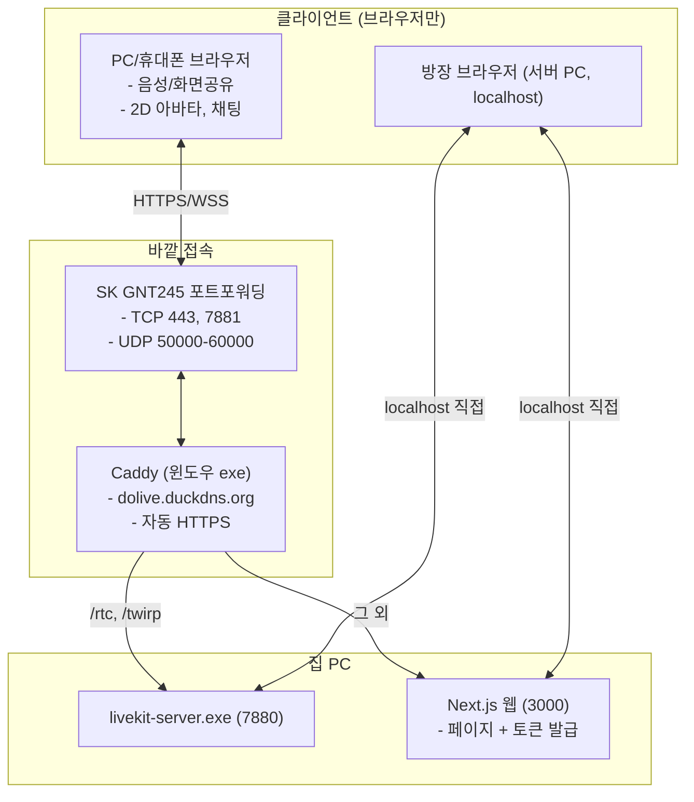

# [기획서] AI 동호회 전용 화상/음성 소통 플랫폼: DOLIVE

> 최종 수정: 2026-09-26. 녹화·AI 요약·음성 인식 기능은 사용자 결정으로 **제외**. 모바일 앱·도커·Redis도 제외.

---

## 1. 프로젝트 개요

* **서비스명**: **DOLIVE** (Do Live)
* **목적**: 디스코드처럼 가볍게 음성·화상·화면공유를 하면서, 동호회용 **음성 반응형 2D 아바타**로 얼굴 없이도 편하게 이야기하는 소통 플랫폼.
* **접속**: **웹 전용**. PC·휴대폰 모두 브라우저로 URL + 닉네임만 입력해 참여 (별도 앱 없음).
* **운영 인프라**: 서버 비용 0원. 개발자 집 PC(Windows 11)를 홈 서버로 사용. **도커 없이** 윈도우 프로그램을 직접 실행.
* **규모**: 한 방 동시 접속 **11~20명** 목표.

---

## 2. 확정 사양 및 정책

| 구분 | 확정 사양 | 구현 방식 |
| :--- | :--- | :--- |
| **인증/접속** | 가입 없이 **캐릭터 선택 + 닉네임 입력(필수)** | 브라우저 세션 스토리지에 저장, 입장 시 토큰 발급 |
| **입장 전 확인** | 제목 없는 미리보기 카드 (닉네임 칸·입장 버튼과의 위아래 간격 35px로 같게), 카드 안 오른쪽 위에 마이크 토글 스위치(켜짐 초록, 꺼짐 회색) | 마이크 소리 막대, 캐릭터 입 모양이 목소리에 반응. 정한 상태 그대로 입장 |
| **입장 제한** | 없음 (주소를 알면 누구나) | 사용자 결정 |
| **방 형태** | **채팅방 하나** | LiveKit 방 이름 `dolive`, 주소 `/room`. 버튼은 "채팅방 입장" 하나 |
| **휘발 정책** | 모두 나가면 채팅 사라짐 | 채팅은 서버에 저장하지 않고 LiveKit으로만 전달 |
| **방장** | **서버 컴퓨터에서 접속한 사람** (표시만) | `localhost`로 직접 들어온 요청만 방장. Caddy를 거치면 방장 아님 |
| **미디어 모드** | 아바타+음성 / 화면공유(1080p). **카메라 없음** (삭제) | LiveKit 트랙 토글. 영상은 화면공유만 |
| **2D 아바타** | 음성 반응형 4종 (PNGtuber) | LiveKit 발화 감지 → `idle.png` / `talk.png` 전환 (흔들림 없음) |

---

## 3. 시스템 구조



---

## 4. 화면 구성 (디스코드식 3단)

```
+---------------------------------------------------------------------------------------------------+
|  DOLIVE  참여자 5명                                        [방장] (화면공유) [마이크 스위치]       |
+-------------------+-----------------------------------------------------------+-------------------+
| [참여자 & 아바타]  |                       [메인 스테이지]                      |    [채팅 내용]     |
| 철수 (말하는 중)   |   화면공유(1080p) 또는 캐릭터 칸                          | [14:02] 영희: ...  |
| 영희 (대기 중)     |                                                           |                   |
| 민수 (음소거)      |                                                           |                   |
+-------------------+-----------------------------------------------------------+-------------------+
|  [ 메시지 보내기 ......................................................... ] [보내기]           |
+---------------------------------------------------------------------------------------------------+
```

* 나가기 버튼 없음 (탭을 닫으면 나감).
* 맨 아래 메시지 입력칸은 카카오톡처럼 항상 보임 (흐린 글자 "메시지 입력", 입력칸·보내기 버튼 높이 48px, 글자 16px, 아래 여백 20px). 보내기를 눌러도 입력칸에 머물러 휴대폰 자판이 닫히지 않음.
* 휴대폰 자판이 올라와도 화면 전체가 밀려 올라가지 않음: 안드로이드는 `layout.tsx`의 `interactiveWidget: "resizes-content"`, 아이폰은 `room/page.tsx`의 `useFitVisibleHeight`(방 높이를 visualViewport 높이에 맞추고 스크롤을 맨 위로 되돌림).
* 휴대폰에서 화면공유 중이면 공유 화면(16:9)을 맨 위에 고정하고 캐릭터 줄은 숨김. 자판이 올라오면 채팅 내용 칸이 먼저 줄고(최소 96px), 그래도 좁으면 공유 화면도 줄어듦.
* "여기를 눌러 소리 켜기" 버튼: 브라우저가 사용자가 누르기 전에는 소리 재생을 막을 때 나오는 LiveKit `StartAudio` 버튼. 한 번 누르면 소리가 나옴. 휴대폰에서는 이 버튼을 숨기고, 화면 아무 데나 처음 누를 때 소리를 켬.
* 휴대폰을 가로로 눕히면(화면 모양이 아니라 기기 방향으로 판단. 세로에서 자판이 올라와도 가로로 착각하지 않게) 화면공유 중일 때 공유 화면만 꽉 차게 보이고 위 막대·참여자·채팅·입력칸은 모두 숨김 (`room/page.tsx`의 `usePhoneLandscape`가 `<html data-phone-land>`를 붙이고 `globals.css`의 `phone-land`가 받음). 공유가 없으면 평소 화면. 가로 화면에서 공유 화면을 누르면 전체화면(주소창·아래 버튼까지 숨김, "화면을 누르면 전체화면" 안내가 아래쪽에 크게 떴다가 4초 뒤 사라짐). 아이폰은 페이지 전체화면이 안 돼서 영상만 아이폰 기본 전체화면으로. 한 번 더 누르거나 세로로 세우면 전체화면 풀림.
* 휴대폰(좁은 화면): 캐릭터 칸 아래에 채팅 내용이 항상 보임. 참여자 목록은 "참여자 N명" 배지(둥근 회색 알약 모양 + 아래 화살표, 열리면 보라색 + 위 화살표)를 눌러 열고 닫음. 화면공유 버튼은 숨김(휴대폰 브라우저는 화면공유 불가).

---

## 5. 2D 음성 반응형 아바타

* **에셋**: `assets/avatars/<영어이름>/idle.png`, `talk.png` (512×512, 투명 배경, 두 장은 입만 다름). Codex 제작.
* 캐릭터 목록 (`apps/web/lib/dolive.ts`): cocomong 코코몽, doraemon 도라에몽, pororo 뽀로로, shinchan 짱구
* 캐릭터를 늘리려면 그림 폴더를 넣고 목록에 한 줄 추가 → `start_dolive.ps1 -Build`.
* 그림이 없으면 임시 동그라미 얼굴. 브라우저에 저장된 캐릭터가 목록에 없으면 첫 캐릭터로.
* 말하면 `talk.png`로 입만 바뀜 (위아래 흔들림은 정신없어서 뺌), 방 안에서 음소거면 어둡게 + 작은 빨간 마이크 꺼짐 표시(캐릭터 오른쪽 아래 구석). 입장 화면 미리보기에는 표시 없음 (스위치 색으로 구분). 캐릭터는 입장 화면에서만 고르고(방 안에서는 못 바꿈), 입장권의 참가자 속성(attributes)으로 모두에게 공유. 참가자가 스스로 속성을 바꾸는 권한(canUpdateOwnMetadata)은 주지 않음.

---

## 6. 폴더 구조

```
DOLIVE/
├── apps/web/                # Next.js 웹 (페이지 + 토큰 발급 API)
├── server/
│   ├── bin/                 # livekit-server.exe, caddy.exe
│   ├── config/              # livekit.yaml, Caddyfile, duckdns.env
│   └── logs/
├── scripts/start_dolive.ps1 # 전부 켜기 (-Local, -Build, -Stop)
└── assets/avatars/          # 4종 캐릭터 (idle.png, talk.png)
```

---

## 7. 진행 상황

* **1단계 완료**: LiveKit 윈도우 exe 설치·실행
* **2단계 완료**: 웹 (닉네임·캐릭터·고정 방, 3단 화면, 음성/캠/화면공유, 아바타, 채팅, 방장 표시)
* **3단계 완료**: DuckDNS + Caddy HTTPS + 포트포워딩. 휴대폰(LTE) 접속 확인
* ~~4단계: 녹화 + AI 요약~~ → 제외
* **캐릭터 그림 적용 완료**: 코코몽, 도라에몽, 뽀로로, 짱구
